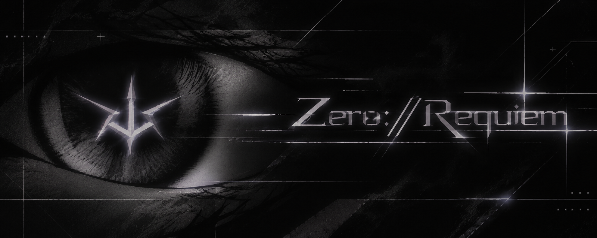

# Zero://Requiem

Web Portal and Discord OAuth2 Mod Panel for the `Zero://Requiem` Discord server.

**Live site:** https://cwazyh.github.io/zero-requiem/  
**Mod panel:** https://cwazyh.github.io/zero-requiem/mod.html  
**Discord:** https://discord.gg/zkfc4kJHUV

This is the single source repository for the static site. It contains no backend code, no `.env`, and no secrets.

## Repository layout

| Path | Purpose |
| --- | --- |
| `index.html` | Home page: server identity, Arthur introduction, element roles, Join Discord and Verify actions |
| `mod.html` | Role-gated Mod Panel entry point |
| `assets/` | Server logo, server banner, Arthur logo, Arthur banner, role icons, styles and frontend scripts |
| `README.md` | This document |

GitHub Pages publishes the `main` branch root.

## Home page

- Server banner and logo using the `1316374` / `2898237` palette.
- `Meet Arthur` section with the bot logo, animated bot banner and feature cards.
- Rules and verification, self roles, leveling, private VCs, tickets, case files and logs, server stats and honeypot.
- Elements strip with all nine self-role icons.

## Mod Panel

The Mod Panel is protected by Discord OAuth2. Access requires guild membership plus the Owner role `1575826666041770046` or the Mod role `1575630074865127434`. It reads bot data through a separately hosted Starlette backend; the client secret never reaches the browser.

The frontend discovers the backend origin from:

`https://cwazyh.github.io/zero-requiem/?api=https://your-backend.example`

The value is stored in `localStorage.zr_api_base` and reused on later visits.

## OAuth redirect

GitHub Pages is static and cannot exchange an authorization code. Register the exact Redirect URI of the backend in the Discord Developer Portal, for example `https://your-backend.example/auth/callback`. Do not use a `cwazyh.github.io` callback URL.

## Security

- No secrets are committed to this repository.
- OAuth state is stored server-side in the session.
- The browser receives only public configuration: invite URL and guild ID.
- All UI text and documentation are in English.
